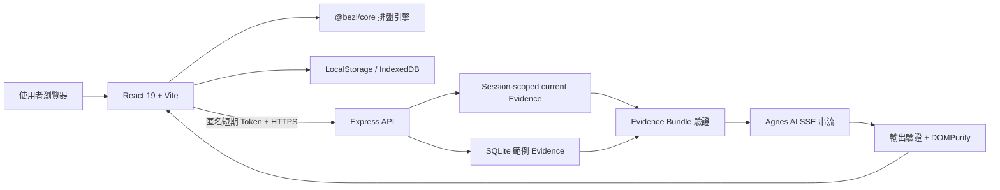

# 八字能量日誌 Bezi

**把傳統八字排盤，整理成每天都看得懂、用得上的個人能量日誌。**

Bezi 不只產生一張命盤。新版把先天命局、大運流年、流月流日、合盤與 AI 問答整合在同一個介面，並加入快速體驗、每日打卡、吻合度回饋與安全分享，讓使用者能持續對照自己的真實生活。

[立即體驗新版 Bezi](https://bezi-ai-api.onrender.com/) · [回報問題](https://github.com/yungtang20/bezi-ai/issues)

> Render 免費服務休眠後，第一次開啟可能需要稍候片刻。本 README 以目前正式站上線版本為準。

## 為什麼使用 Bezi

- **不用先懂命理**：從清楚的圖表、白話說明與生活專項開始，不必先背誦十神或五行規則。
- **可以先試再決定**：不想輸入資料時，可直接開啟範例命盤體驗完整流程。
- **不知道出生時辰也能使用**：只填年月日即可進行有邊界的前三柱、格局、大運與流年分析。
- **不強迫完成校準**：人生事件校準能提高個人化程度，也可以先跳過查看完整結果。
- **每天都有新內容**：今日能量、流日詳解、打卡與連續天數，讓命盤從一次性報告變成日常觀察工具。
- **AI 不憑空猜測**：AI 只根據伺服器重新計算並驗證過的當次命盤 Evidence 回答；資料不足時會安全拒答。
- **分享前先看清楚**：產生分享圖前會先顯示隱私預覽，預設不包含姓名、日主、喜用神或最弱五行。

## 主要功能

### 命盤與校準

- 四柱／前三柱排盤
- 五行強弱與十神比例
- 格局、日主、喜用神與最弱五行
- 兩個歷史年份的人生事件校準
- 一鍵範例命盤與略過校準

### 每日與長期觀測

- 今日能量與行動建議
- 每日打卡、連續天數與歷史回顧
- 預測吻合度報告
- 十年大運、流年、流月與流日
- 健康、事業、財富、感情、家庭與人際專項

### 合盤、知識與分享

- 雙方命盤與五行互動觀察
- 理論速查與命理知識搜尋
- 今日運勢與合盤分享圖
- 分享前隱私預覽
- LINE 與系統分享支援

### AI 命理問答

- 自動建立匿名短期工作階段
- 由後端依出生資料重新排盤
- Session-scoped current Evidence
- Agnes AI SSE 即時串流
- Evidence 引用與輸出結構驗證
- 停止、重試與命理術語提示

## 使用流程

1. 輸入姓名、性別、出生日期與選填的出生時間，或直接開啟範例命盤。
2. 完成人生事件校準，或選擇「先看完整結果，稍後再校準」。
3. 從「命局、歲運、專項、流日、合盤、理論」探索不同分析。
4. 查看今日能量、完成打卡，並持續回饋實際感受。
5. 需要進一步說明時，再開啟 AI 問答。

## 資料與隱私

Bezi 採取 local-first 設計，並把 AI 使用情境獨立隔離：

- 姓名、出生資料、校準與日誌主要保存在目前瀏覽器裝置。
- 只有開啟 AI 問答時，出生日期、時辰與性別才會送至本服務後端，用於建立當次工作階段的驗證命盤；**不會送出姓名**。
- AI 工作階段使用短期匿名 Token，當次命盤 Evidence 只允許建立它的 Session 存取。
- 產品事件只在本機保存彙總次數，不記錄生日、命盤或問答內容，也不傳送至外部分析平台。
- Agnes API 金鑰只存在伺服器環境變數，不會進入前端 bundle 或瀏覽器儲存空間。
- AI 回應會通過 Evidence 結構驗證，並由 DOMPurify 清理後才顯示。
- 分享圖預設使用最少必要資訊；額外個人資訊必須由使用者明確選擇加入。

> 命理內容僅供文化研究、自我觀察與生活參考，不構成醫療、投資、法律或其他專業建議。

## 新版架構

| 區域 | 新版技術與責任 |
| --- | --- |
| Web UI | React 19、TypeScript、Vite、Tailwind CSS、Motion、Recharts |
| 命理核心 | `@bezi/core`、`lunar-javascript`；排盤、格局、大運與流日 |
| 每日體驗 | 今日能量、打卡、吻合度、分享與本機產品事件 |
| API | Express、匿名 Session、CORS、Rate Limit、輸入驗證與 SSE |
| AI 安全 | Current／SQLite Evidence Bundle、來源驗證、缺資料時 fail closed |
| 儲存 | 瀏覽器 LocalStorage／IndexedDB；短期記憶體 Evidence |
| 品質 | TypeScript、Vitest、Node API tests、Playwright production smoke |

## 正式服務狀態

正式站：[https://bezi-ai-api.onrender.com/](https://bezi-ai-api.onrender.com/)

已完成的唯讀瀏覽器檢查：

- 桌機、平板與手機首頁可正常渲染。
- 範例命盤可完成「首頁 → 校準 → Dashboard」流程。
- 測試期間沒有 Console error、失敗請求或 4xx／5xx。
- 375px 手機版沒有水平溢位。

目前已知改善項目：

- 首屏 LCP 單次實驗室量測約 2.74 秒，仍可繼續最佳化。
- 首頁文字輸入框需要補強程式化 label。
- 此正式站目前沒有獨立 JSON health endpoint；`/health/live` 與 `/health/ready` 會落到 SPA 首頁，不能視為 readiness 證據。
- AI 實際回答仍需另外以受控測試驗證，不能只由畫面載入推定正常。

## Repository 狀態

本 README 已改以新版正式站為產品基準。`bezi-ai` 與新版正式站來源目前仍是兩個不同的程式碼歷史；本次只更新 GitHub 產品說明，**不代表兩個 repository 的原始碼已完成同步或遷移**。

若要開發或部署，必須先確認目前要維護的是新版正式站來源，避免把舊版 Render Blueprint、授權流程或 API 路由誤套到新版。

## 貢獻與安全回報

- 開發流程請參考 [CONTRIBUTING.md](./CONTRIBUTING.md)。
- 命理規則或知識資料變更必須保留可追溯來源，詳見 [docs/domain-sources.md](./docs/domain-sources.md)。
- 安全問題請依 [SECURITY.md](./SECURITY.md) 私下聯絡維護者，不要在公開 Issue 張貼憑證、出生資料或可利用細節。
