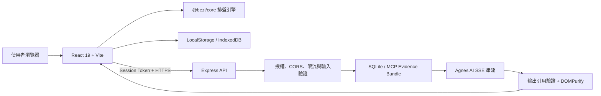

# Bezi AI｜八字命理分析與歲運觀測

[](https://github.com/yungtang20/bezi-ai/actions/workflows/ci.yml)
[](https://github.com/yungtang20/bezi-ai/actions/workflows/codeql.yml)


**把排盤、格局、歲運、生活專項與 AI 問答，整理成一套可持續對照人生經驗的八字分析工具。**

Bezi AI 以子平八字為核心，從出生資料建立命盤，再透過人生事件校準、大運流年、流月流日、六大生活專項、合盤與理論對照，協助使用者用一致的介面理解命理資訊。

[開啟 GitHub Pages](https://yungtang20.github.io/bezi-ai/) · [開啟完整 Render 服務](https://bezi-ai-api-yungtang20.onrender.com/) · [回報一般問題](https://github.com/yungtang20/bezi-ai/issues)

> Render 免費服務休眠後，第一次開啟可能需要稍候片刻。AI 問答需要部署者提供授權密碼，並選擇伺服器已有的命盤 Evidence。

## 主要功能

- **八字排盤**：顯示四柱、藏干、十神、五行分布、日主與格局；出生時間可留空，改以年月日進行前三柱分析。
- **人生事件校準**：使用兩個歷史年份的「順利／不順／平穩」回饋，調整格局分數後再進入完整分析。
- **先天命局**：整理個性核心、外在展現、私下特質、喜用神與五行補運方向。
- **大運流年**：呈現十年大運與年度變化，讓長期趨勢和單年事件能放在同一條時間軸比較。
- **流月流日**：查看每月日曆、每日六大領域能量、日誌與歷史回顧。
- **六大生活專項**：深入查看健康、事業、財富、感情、家庭及朋友人際分析。
- **合盤配對**：從雙方命盤、五行與十神互動觀察關係傾向。
- **理論對照與搜尋**：把基礎規則、專項說明與講義知識整理成可查詢內容。
- **AI 命理問答**：以 Agnes AI SSE 串流回覆，並以伺服器端 Evidence Bundle 限制可回答範圍。

## 使用流程

1. 輸入姓名、性別、出生日期，以及選填的出生時間。
2. 完成兩個歷史年份的事件校準。
3. 從「命局、歲運、專項、流日、合盤、理論」切換不同分析。
4. 如有 AI 權限，輸入授權密碼、選擇伺服器命盤記錄，再開始提問。

## 資料與 AI 邊界

Bezi AI 將一般排盤與 AI 問答分開處理：

- 姓名、出生資料、校準與日誌主要保存在目前瀏覽器的 LocalStorage 或 IndexedDB。
- AI 問答啟用後，問題、自訂引導、畫面命盤脈絡及選定的 `record_id` 會送到後端；使用者應避免輸入不必要的個人資訊。
- 授權密碼只用來交換短期 Session Token；Token 與選定記錄存放在 SessionStorage。
- 前端不能自行提交 Evidence Bundle。後端只使用受信任的 SQLite／MCP Evidence，缺少資料時會拒絕推測。
- `AGNES_API_KEY` 只存在伺服器環境變數，不會打包進前端，也不接受瀏覽器提供的 API key。
- AI 回應需通過結構化 Evidence 驗證，顯示前再由 DOMPurify 清理。
- 伺服器會驗證授權、來源、請求頻率、訊息筆數與內容長度。

> 本專案的命理內容僅供文化研究、娛樂與自我觀察，不構成醫療、投資、法律或其他專業建議。

## 系統架構



### 技術組成

| 區域 | 技術與責任 |
| --- | --- |
| Web UI | React 19、TypeScript、Vite、Tailwind CSS、Motion、Recharts |
| 命理核心 | `@bezi/core`、`lunar-javascript`；排盤、格局、大運、流年與圖表轉換 |
| 知識層 | `src/domain/`、`src/data/`、`LLM_WIKI.md` 與來源治理文件 |
| API | Express、短期 Session、CORS、Rate Limit、輸入驗證、SSE |
| AI 安全 | Server-side Evidence Bundle、引用驗證、缺資料時 fail closed |
| 儲存 | 瀏覽器 LocalStorage／IndexedDB；伺服器 SQLite Evidence |
| 品質 | TypeScript、Vitest、Node API tests、Playwright、Docker smoke、CodeQL |

## 線上部署

| 入口 | 用途 |
| --- | --- |
| [GitHub Pages](https://yungtang20.github.io/bezi-ai/) | 靜態前端，透過 `VITE_API_BASE_URL` 呼叫 Render API |
| [Render](https://bezi-ai-api-yungtang20.onrender.com/) | 前端靜態資源與 Express API 的完整服務 |
| [`/health/live`](https://bezi-ai-api-yungtang20.onrender.com/health/live) | 程序存活檢查 |
| [`/health/ready`](https://bezi-ai-api-yungtang20.onrender.com/health/ready) | 啟動設定與服務就緒檢查 |

`render.yaml` 使用 Docker 部署，並在 CI checks 通過後自動部署 `main`。Render 免費實例的檔案系統不適合保存持久寫入；若未來需要修改 SQLite 資料，應使用 Persistent Disk 或外部資料庫。

## 本機開發

### 需求

- Node.js 22 或更新版本
- npm

### 安裝

```bash
git clone https://github.com/yungtang20/bezi-ai.git
cd bezi-ai
npm ci
```

複製環境設定：

```bash
# macOS / Linux
cp .env.example .env.local

# Windows PowerShell
Copy-Item .env.example .env.local
```

設定必要的伺服器端環境變數：

```env
AGNES_API_KEY=your_server_only_agnes_key
BEZI_AUTH_CLIENT_SECRET=your_server_only_auth_secret
AGNES_BASE_URL=https://apihub.agnes-ai.com/v1
AGNES_MODEL=agnes-3.0-flash
ALLOWED_ORIGINS=http://localhost:3000,http://localhost:5173
PORT=3000
```

請勿使用 `VITE_` 前綴存放任何 secret。Production 必須明確設定允許的瀏覽器來源；多實例部署則應把目前的記憶體限流器替換為共享儲存方案。

### 啟動與建置

```bash
# 開發模式：http://localhost:3000
npm run dev

# Production bundle 與 server
npm run build
npm start
```

## API 概覽

| Method | Endpoint | 用途 |
| --- | --- | --- |
| `GET` | `/health/live` | 存活檢查 |
| `GET` | `/health/ready` | 就緒檢查 |
| `POST` | `/api/auth/token` | 以部署者密碼交換短期 Session Token |
| `GET` | `/api/records` | 取得授權範圍內的命盤 Evidence 摘要 |
| `POST` | `/api/chat` | 依選定 Evidence 執行 Agnes AI SSE 問答 |

`/api/records` 與 `/api/chat` 必須攜帶 Bearer Session Token。`/api/chat` 還需要有效的 `record_id`；沒有可信 Evidence 時會回傳安全拒答，而不是自行補完命盤資訊。

## 測試與品質門檻

```bash
# TypeScript 靜態檢查
npm run lint

# Vitest 單元測試
npm test

# API validation tests
npm run test:api

# Playwright 瀏覽器流程
npm run test:e2e

# Production build
npm run build
```

CI 另會執行 dependency audit、Docker build、production container smoke test，以及獨立的 CodeQL 分析。

修改 `packages/core` 後，另執行：

```bash
npx tsc -p packages/core/tsconfig.json --noEmit
```

## 專案結構

```text
bezi-ai/
├─ packages/core/       # 排盤、格局、大運、流年等共用核心
├─ src/components/      # 命局、歲運、專項、流日、合盤與 AI 介面
├─ src/domain/          # 有來源治理的命理規則模組
├─ src/data/            # 表格、規則與講義知識資料
├─ src/ai/              # Evidence 與 AI 輸出驗證
├─ src/lib/             # API、儲存與安全相關工具
├─ docs/                # Domain source、部署與維護文件
├─ tests/               # 單元、API 與 Playwright E2E
├─ server.ts            # Express、授權、限流與 Agnes SSE proxy
├─ LLM_WIKI.md          # 命理知識來源與規則索引
└─ render.yaml          # Render Blueprint
```

## 貢獻與安全回報

- 開發流程與必要檢查請參考 [CONTRIBUTING.md](./CONTRIBUTING.md)。
- 命理規則、講義或 `src/data/` 變更必須附上可追溯來源，詳見 [docs/domain-sources.md](./docs/domain-sources.md)。
- 安全問題請依 [SECURITY.md](./SECURITY.md) 私下聯絡維護者，不要在公開 Issue 張貼憑證、個人出生資料或可利用細節。
