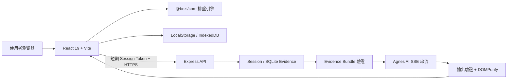

# 八字能量日誌 Bezi

[](https://github.com/yungtang20/bezi-ai/actions/workflows/ci.yml)


**把傳統八字排盤，整理成每天都看得懂、用得上的個人能量日誌。**

Bezi 不只產生一張命盤。它把先天命局、大運流年、流月流日、合盤與 AI 問答整合在同一個介面，並透過校準、每日打卡和分享功能，讓使用者能持續對照自己的真實生活。

[立即體驗 Bezi](https://bezi-ai-api.onrender.com/) · [回報問題](https://github.com/yungtang20/bezi-ai/issues)

> Render 免費服務休眠後，第一次開啟可能需要稍候片刻。

## 你可以用 Bezi 做什麼

- **快速開始**：不知道怎麼填也可以先看範例命盤；不知道出生時辰時，仍能使用年月日進行有邊界的三柱分析。
- **查看完整命局**：整理四柱、五行強弱、十神、格局、喜用神與性格方向。
- **對照大運流年**：查看十年大運、年度趨勢，以及流月、流日的能量變化。
- **探索生活專項**：從職涯、財富、健康、感情與居家等主題切入，而不是只閱讀抽象術語。
- **進行合盤分析**：比較雙方五行、十神與互動傾向，並產生可分享的合盤摘要。
- **詢問 AI 命理助手**：AI 只能根據伺服器驗證過的命盤 Evidence 回答，資料不足時會拒絕猜測。
- **建立每日回訪習慣**：查看今日能量、完成打卡、追蹤連續天數，並用實際感受回饋命理結果。
- **越用越準**：打卡與校準結果會累積成分數，格局標籤可能隨證據自動修正（切換時明確告知因果）。
- **安全分享結果**：分享前先預覽內容；預設不包含姓名、日主、喜用神或最弱五行。
- **手機可安裝**：PWA 支援，加入主畫面即可離線開啟已載入的頁面（AI 問答仍需網路）。

## 使用流程

1. 輸入姓名、性別、生日與出生時辰，或直接開啟範例命盤。
2. 透過兩個人生事件校準格局；也可以先跳過，直接查看完整結果。
3. 從「命局、歲運、專項、流日、合盤、理論」切換分析，或開啟 AI 問答。

## 我們如何處理資料

Bezi 採取 local-first 設計，並把 AI 使用情境另外隔離：

- 姓名、出生資料、校準與日誌主要保存在使用者目前的瀏覽器裝置。
- 只有開啟 AI 問答時，出生日期、時辰與性別才會送至本服務後端，建立該工作階段的驗證命盤；**不會送出姓名**。
- AI 工作階段使用短期 token，當次命盤 Evidence 只允許建立它的工作階段存取。
- 產品使用事件只在本機保存彙總次數，不記錄生日、命盤或問答內容，也不傳送至外部分析服務。
- Agnes API 金鑰只存在伺服器環境變數，不會進入前端 bundle、瀏覽器儲存空間或使用者請求。
- AI 回應會經結構化 Evidence 驗證與 DOMPurify 清理後才顯示。

> 命理內容僅供文化研究、自我觀察與生活參考，不構成醫療、投資、法律或其他專業建議。

## 系統架構



### 技術組成

| 區域     | 技術與責任                                                                                                                  |
| -------- | --------------------------------------------------------------------------------------------------------------------------- |
| Web UI   | React 19、TypeScript、Vite、Tailwind CSS、Motion、Recharts                                                                  |
| 命理核心 | `@bezi/core`、`lunar-javascript`；排盤、格局、大運、流年與圖表轉換                                                          |
| API      | Express、短期授權、輸入驗證、限流、SSE 串流                                                                                 |
| AI 安全  | Server-side Evidence Bundle、輸出引用驗證、缺資料時 fail closed                                                             |
| 儲存     | 瀏覽器 LocalStorage／IndexedDB；伺服器 SQLite 範例 Evidence                                                                 |
| 品質     | TypeScript、Vitest 195 測試、Node API tests 26 項、Playwright 30 案（onboarding/chat/stress/prod-smoke）、GitHub Actions CI |

## 本機執行

### 需求

- Node.js 24（與 CI、Docker 環境一致）
- npm

### 安裝與設定

```bash
git clone https://github.com/yungtang20/bezi-ai.git
cd bezi-ai
npm ci
```

複製環境設定範例：

```bash
# macOS / Linux
cp .env.example .env.local

# Windows PowerShell
Copy-Item .env.example .env.local
```

至少設定下列伺服器端變數：

```env
AGNES_API_KEY=your_server_only_agnes_key
BEZI_AUTH_CLIENT_SECRET=your_server_only_auth_secret
ENABLE_ANONYMOUS_CHAT=true
AGNES_BASE_URL=https://apihub.agnes-ai.com/v1
AGNES_MODEL=agnes-3.0-flash
ALLOWED_ORIGINS=http://localhost:3000,http://localhost:5173
```

請勿使用 `VITE_` 前綴存放任何 secret。`ENABLE_DEV_AUTH_BYPASS` 與 `ENABLE_DEV_FIXTURE` 只能用於本機 development 測試。

### 啟動

```bash
npm run dev
```

開啟 <http://localhost:3000>。

### Production build

```bash
npm run build
npm start
```

建置程式會在載入 Vite 前固定 production 環境，避免本機 `.env.local` 讓正式 bundle 誤帶 React development runtime。

## API 概覽

| Method | Endpoint                | 用途                                       |
| ------ | ----------------------- | ------------------------------------------ |
| `POST` | `/api/auth/token`       | 建立短期聊天工作階段                       |
| `GET`  | `/api/records`          | 取得可用命盤 Evidence 摘要                 |
| `POST` | `/api/evidence/current` | 由目前出生資料建立 session-scoped Evidence |
| `POST` | `/api/chat`             | 一般八字 AI 問答（SSE）                    |
| `POST` | `/api/chat/dayun`       | 大運流年 AI 問答（SSE）                    |
| `POST` | `/api/chat/synastry`    | 合盤 AI 問答（SSE）                        |

聊天端點必須攜帶 Bearer Session Token 與有效的 `record_id`。前端不能直接提交或偽造 Evidence Bundle。

## 測試

```bash
# TypeScript 靜態檢查
npm run lint

# Vitest 單元測試
npm test

# API integration tests（5 檔、26 測試：chat 驗證、CORS、dev-auth、evidence/knowledge pipeline）
npm run test:api

# 建置後執行完整瀏覽器流程（onboarding/chat/stress 30 案）與 production smoke
npm run build
npm run test:e2e
```

E2E 有四套 spec：

| Spec                 | 覆蓋                                                                                                                                                    |
| -------------------- | ------------------------------------------------------------------------------------------------------------------------------------------------------- |
| `onboarding.spec.ts` | 範例建盤、校準閉環、reload 還原、真太陽時城市快選                                                                                                       |
| `chat-flow.spec.ts`  | 匿名授權、SSE 渲染 term tooltip、打卡吻合度、四區導覽、多視窗                                                                                           |
| `prod-smoke.spec.ts` | production bundle 掛載與同源資源 CORS                                                                                                                   |
| `stress.spec.ts`     | 5 格局種子 onboarding、全頁面走查、快速跨頁切換、reload/deep-link 持久化、三日連續打卡、合盤分享圖、AI 問答、手機導覽、錯誤輸入驗證（全案 pageerror=0） |

修改 `packages/core` 後，另執行：

```bash
npx tsc -p packages/core/tsconfig.json --noEmit
```

## 專案結構

```text
bezi-ai/
├─ packages/core/       # 排盤、格局、大運、流年等共用核心（子平法引擎）
├─ src/components/      # 命局、歲運、專項、合盤、AI 與分享介面（41 頁面組件）
├─ src/components/*/sections/  # 各專項頁 ContentSection 內容區塊（講義文法：結論→依據→時間窗→動作）
├─ src/data/            # 核心表格、規則與課程知識資料（charts/rules/lecture/core）
├─ src/ai/              # Prompt、知識管線（分類→檢索）、Evidence 與 AI 輸出驗證
├─ src/hooks/           # useAppStep、useBirthChart、useCalibration 等狀態機
├─ src/lib/             # 儲存、安全、分享、準確率報告與產品事件工具
├─ tests/               # Vitest 單元（24 檔）、API 整合（5 檔）、Playwright E2E（4 套）
├─ server.ts            # Express API、授權、限流、知識管線與 Agnes SSE proxy
├─ LLM_WIKI.md          # 命理知識來源與規則索引（domain rule provenance）
├─ Dockerfile / render.yaml  # 單一 image 部署（Render）
└─ .github/workflows/ci.yml  # lint + test + test:api + build + prod-smoke
```

## 排盤方法與正確性證據

### 命理口徑來源：徐玉蘭老師教學框架

Bezi 的命理斷法**不是泛泛的網路八字**，而是對齊徐玉蘭 Master Hsu 的教學體系（官方網站 [masterhsu.com.tw](https://www.masterhsu.com.tw/)、知識衛星課程「人生八字應用課」與「風水磁場順心術」、YouTube 頻道 [@masterhsutalk](https://www.youtube.com/@masterhsutalk)）：

- **四層讀盤序**：找日主 → 定格局 → 抓用神 → 疊大運流年，UI 流程即按此設計。
- **格局加權**：年干 5%、年支 20%、月干 35%、日支 20%、時支 10%（七字計分，日干不計）；含貪生忘剋（限日柱旁）、透干成庫、40–55% 連續體不硬貼標籤。
- **定盤**：分數只是工具，定盤（流年體感回測）才是裁判——app 內「兩個年份校準題」與打卡回饋就是這一步的產品化。
- **用神與補運**：一般格局求平衡、從格求順勢；大運前五年走天干、後五年走地支；起運歲數不採計。
- **寵物與五行**：寵物在八字當「食神傷官」看，挑選以命盤所需五行對應動物屬性（貓兔木火、狗火土、缺金水選鳥倉鼠蛇魚龜）；責任心永遠比開運更重要。
- **知識內容**（`src/data/`）：核心表格、規則與講義知識的 provenance 逐條記錄於 [LLM_WIKI.md](./LLM_WIKI.md)；徐玉蘭推薦的古籍（《三命通會》《窮通寶鑑》《滴天髓》《命理探源》）僅為延伸書單，不作口徑來源。

> 本專案為獨立實作，口徑以徐玉蘭老師的公開教學框架為準；與市售排盤軟體的差異見下方學派說明。

### 排盤學派

排盤引擎（`packages/core/src/paipan.ts`）採用**子平法／立春學派**：

- **年柱**：立春**精確時刻**換年（`getYearInGanZhiExact`），非農曆正月初一。
- **月柱**：節氣**精確時刻**換月（`getMonthInGanZhiExact`），非節氣日 00:00。
- **日柱**：六十甲子週期（與 JDN 公式、1949-10-01=甲子錨點獨立驗證一致）。
- **時柱**：早子時（23:00–23:59）日柱維持當日、時柱為次日日干之子時（lunar-javascript EightChar 標準行為，已以回歸測試釘住）。
- **大運順逆**：年干陰陽 × 性別，與年柱同一學派，內部一致。

**正確性證據鏈**（不依賴引擎自我宣告）：

1. 節氣時刻以 Meeus 低精度太陽黃經獨立計算交叉驗證（立春 1995 = 02-04 07:19 UTC、立春 2000 = 02-04 12:36 UTC、清明 1984 = 04-04 14:28 UTC 等）。
2. 日柱以 JDN 六十週期公式（錨點 1949-10-01 = 甲子）獨立驗證。
3. `tests/unit/paipan.test.ts`、`tests/unit/dayun.test.ts` 為 golden 回歸測試：四柱、起運年齡、流年干支與十神皆硬編碼獨立驗證值，含立春前/後邊界案例。（依徐玉蘭口徑，起運歲數僅供顯示區間、不作為判定因素。）

> 注意：立春學派與農曆正月初一學派在每年 1 月中～2 月中（約 2-3 週窗口）的出生者年柱不同。引擎與市售八字排盤軟體一致採立春學派；若需對照另一學派，請以該窗口的年柱差異自行判斷。

## 部署

專案以單一 Docker image 同時提供前端靜態資源與 Express API。`render.yaml` 已定義 Render Web Service，推送至 `main` 後可由 Render 自動部署。

部署環境至少需要設定：

- `AGNES_API_KEY`
- `BEZI_AUTH_CLIENT_SECRET`

`data/bezi.db` 目前用於唯讀範例 Evidence。若未來加入伺服器端持久寫入，不應依賴 Render 免費實例的暫存檔案系統，應改用 Persistent Disk 或外部資料庫。

## 安全政策

發現安全問題時，請先閱讀 [SECURITY.md](./SECURITY.md)，不要在公開 Issue 中張貼 API key、個人出生資料或可被利用的完整細節。
